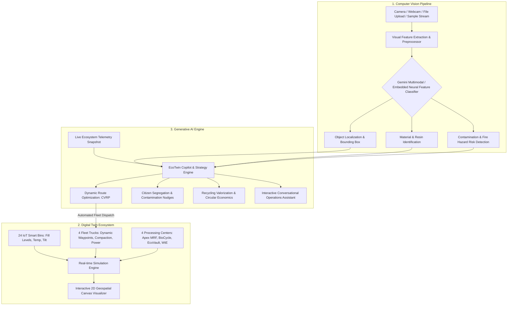

# EcoTwin: Smart Waste Computer Vision, Digital Twin & Generative AI Ecosystem

**EcoTwin** is a full-stack, enterprise-grade municipal and industrial waste intelligence system. It integrates:
1. **Computer Vision (CV)** to detect, classify, and localize waste items, identifying polymer resin codes (PET, HDPE, PP), recyclability potential, and contamination risks (e.g. food grease, lithium-ion battery fire hazards).
2. **Digital Twin of the Waste Management Ecosystem**: A real-time spatial and operational model of a metropolitan district with 24 IoT smart bins, 4 dynamic municipal collection trucks, and 4 specialized processing facilities (MRF, Anaerobic Digester, E-Waste Vault, Waste-to-Energy).
3. **Generative AI Recommendation Engine & Copilot**: Multi-agent reasoning for dynamic route optimization (Capacitated Vehicle Routing Problem - CVRP), targeted citizen segregation nudges, secondary commodity valorization ($/ton), and an interactive operational AI copilot.

---

## 🏛️ System Architecture



---

## 🚀 Key Features

### 1. Computer Vision Waste Classifier & Optical Sorter
- **Taxonomy Covered**:
  - `Plastics`: Clear PET (#1), HDPE (#2), LDPE film (#4), PP containers (#5), Polystyrene (#6).
  - `Paper & Cardboard`: Corrugated cartons (OCC), office fiber, food-soiled pizza boxes (contaminants).
  - `Metals`: UBC Aluminum cans, steel/tin food cans.
  - `Glass`: Clear & amber soda-lime container cullet.
  - `Organics`: Food scraps, peelings, yard biomass.
  - `E-Waste`: Lithium-ion battery packs, micro-electronics (severe thermal runaway hazards).
  - `Landfill / Residual`: Multi-layer metallized sachets, composite packaging.
- **Inference Modes**:
  - **Sample Gallery**: 1-click test items with embedded vector SVGs, labels, and pre-computed features.
  - **File Upload**: Drag-and-drop any photo (PNG, JPG, WEBP).
  - **Live Webcam**: Stream video from camera and capture frames for instant classification.
  - **MRF Industrial Optical Sorter Conveyor Belt Simulation**: Watch items pass along a conveyor belt, get scanned by an oscillating laser, and trigger pneumatic air-jet ejection for non-recyclable contaminants!

### 2. Digital Twin of the Waste Management Ecosystem
- **Metropolitan Model**: Divided into 5 distinct sectors:
  - *Sector 1: Downtown Commercial Hub*
  - *Sector 2: Oakwood Residential Suburb*
  - *Sector 3: CyberTech Innovation District*
  - *Sector 4: Bayside Harbor & Markets*
  - *Sector 5: GreenValley Industrial Park*
- **Entities**:
  - **24 Smart Bins**: Live ultrasonic fill sensors, battery levels, internal temperature, contamination indices, and lid tilt sensors.
  - **4 Specialized Fleet Trucks**: Electric compactors, Bio-CNG heavy trucks, Rapid response EVs, and Hazmat containment vehicles. Trucks navigate dynamically between bins and offload at processing facilities.
  - **4 Facilities**:
    - Apex Materials Recovery Facility (MRF)
    - BioCycle Anaerobic Digestion Plant (Organics & Biogas)
    - EcoVault Specialized E-Waste & Battery Depot
    - CleanThermal Waste-to-Energy Plant (WtE)
- **Time Dilation & Scenarios**:
  - Speed controls: `Pause`, `1x`, `5x`, `15x`.
  - Injected Scenarios: `Morning Rush Hour`, `Festival Surge (Bayside)`, `Heavy Rain Contamination Event`.

### 3. Generative AI Recommendations & EcoTwin Copilot
- **4 Actionable Recommendation Modules**:
  1. *Segregation & Contamination Mitigation*: Identifies contamination hotspots and recommends dual-aperture smart lids and targeted citizen nudges.
  2. *Dynamic Route Optimization (CVRP)*: Replaces static route schedules with predictive dynamic clustering, preventing overflows while reducing fuel consumption and greenhouse gas emissions.
  3. *Recycling Valorization & Circular Economics*: Calculates secondary commodity resale value ($/ton for rPET flakes, clean aluminum, organic compost) and virgin polymer offsets.
  4. *Infrastructure & Hazard Prevention*: Thermal monitoring and automated smart lid locks for lithium-ion fire containment.
- **Interactive EcoTwin Copilot**:
  - Conversational assistant grounded in live telemetry.
  - Executable action buttons (e.g. click to trigger fleet dispatch).
  - Dual Mode: Powered by Google Gemini 1.5 Flash when an API key is provided, or by the built-in autonomous contextual reasoning engine.

---

## 🛠️ Installation & Quickstart

### Prerequisites
- Python 3.11+
- Web browser (Chrome, Edge, Firefox, Safari)

### Quick Run (Windows)
Double-click `run.bat` or run:
```bash
python app.py
```

Then open your browser at:
```
http://127.0.0.1:5000
```

### (Optional) Gemini API Key
To enable Gemini 1.5 Flash multimodal vision and agent reasoning, set the environment variable or enter it in the UI key configuration modal:
```bash
set GEMINI_API_KEY="AIzaSy..."
python app.py
```

---

## 📐 Mathematical Formulation

### 1. Landfill Diversion Rate
$$\text{Diversion Rate (\%)} = \left( \frac{W_{\text{diverted}}}{W_{\text{total\_collected}}} \right) \times 100$$
Where:
- $W_{\text{diverted}} = W_{\text{MRF\_sorted}} + W_{\text{composted}} + W_{\text{e-waste\_recovered}} + (0.35 \times W_{\text{WtE\_ash}})$
- $W_{\text{total\_collected}} =$ Gross weight of collected municipal waste.

### 2. Carbon Mitigation Model
$$\Delta \text{CO}_{2\text{e}} = \sum_{c \in \text{Categories}} \left( m_c \times f_c \right) - \left( d_{\text{fleet}} \times e_{\text{truck}} \right)$$
Where:
- $m_c =$ Diverted mass of material category $c$ (kg).
- $f_c =$ Avoided virgin extraction carbon factor ($1.45$ for PET, $4.20$ for Aluminum, $0.75$ for Compost).
- $d_{\text{fleet}} =$ Total kilometers driven by the collection fleet.
- $e_{\text{truck}} =$ Average emissions per vehicle kilometer ($0.0$ for Electric EV, $0.28 \text{ kg CO}_2/\text{km}$ for Bio-CNG).

### 3. Dynamic Fleet Capacitated Vehicle Routing (CVRP)
$$\min \sum_{i} \sum_{j} c_{ij} x_{ij}$$
Subject to:
$$\sum_{i \in \text{Route}} q_i \le Q_{\text{truck\_capacity}}$$
$$\text{Fill}_i(t) \ge \theta_{\text{critical}} \implies i \in \text{Planned Waypoints}$$
Where $q_i$ is the forecasted mass of bin $i$ at time of arrival, ensuring zero overflow events while minimizing total distance $c_{ij}$.

---

## 📂 Project Structure

```
eco-vision-twin/
├── app.py                      # Flask REST API & Web Application
├── config.py                   # Configuration, parameters & commodity rates
├── cv_engine/
│   ├── __init__.py
│   ├── classifier.py           # Computer Vision Classifier & Localization
│   ├── material_db.py          # Resin taxonomy & preparation guides
│   └── test_samples.py         # Curated sample gallery & optical sorter simulation
├── digital_twin/
│   ├── __init__.py
│   ├── ecosystem.py            # State: 24 Smart Bins, 4 Trucks, 4 Facilities
│   ├── simulator.py            # Physics simulation & CVRP vehicle routing
│   └── analytics.py            # Telemetry KPIs & 4h overflow risk projection
├── genai_engine/
│   ├── __init__.py
│   ├── copilot.py              # Generative AI Agent (Gemini + Local Contextual)
│   └── prompts.py              # System prompts & operational schemas
├── static/
│   ├── css/style.css           # Modern Dark UI Theme & Glassmorphism
│   └── js/
│       ├── main.js             # State coordination & sim heartbeat
│       ├── cv_view.js          # Vision scanner, webcam & conveyor view
│       ├── twin_view.js        # Geospatial canvas & vehicle path rendering
│       └── copilot_view.js     # Copilot chat & recommendation cards
├── templates/
│   └── index.html              # Single Page Application
├── requirements.txt
├── run.bat                     # Windows Launcher
└── README.md
```
